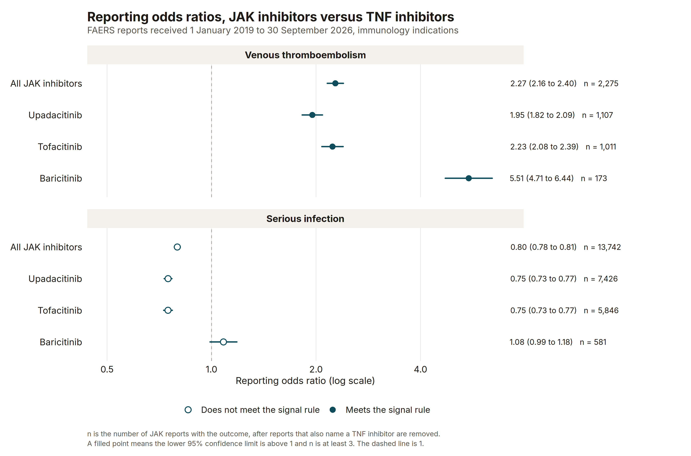
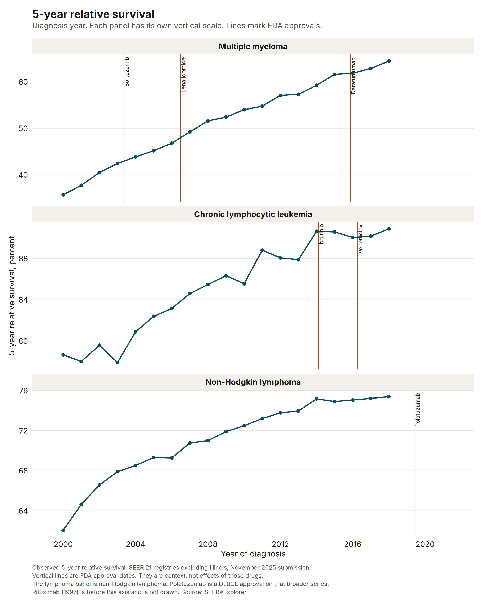

# Real-world evidence

Dr. Rishad Ahmed. PhD in Public Health, MBA.

This is a portfolio of reproducible real-world evidence and epidemiology analyses of public data. A study here starts with a protocol and an analysis plan, then keeps the code, the tests, and the aggregate results. The work is mine. It is not a statement from Nebraska DHHS or from any employer.

More studies are coming.

## Studies

| Study | Question | Data | Design | Result |
| --- | --- | --- | --- | --- |
| [Usual sleep and frequent mental distress, BRFSS 2022](brfss-2022-sleep-fmd/) | Among adults in the 50 states and the District of Columbia, how much more common is frequent mental distress in people who report usual sleep under 7 hours than in people who report 7 to 9 hours? | Public CDC BRFSS 2022 combined landline and cell-phone file, `LLCP2022XPT.zip`. 445,132 records. Zip SHA-256 `b6319c949b7289f8020fc903c3c2d38fe7e0b28ad703dcd81547f5cd0c0dcfeb`. | Complex survey. Weight `_LLCPWT`, strata `_STSTR`, PSU `_PSU`. | Among 407,452 adults, frequent mental distress was 23.43% (95% CI 22.97% to 23.89%) under 7 hours and 10.61% (95% CI 10.36% to 10.86%) at 7 to 9 hours. The difference is 12.82 percentage points (95% CI 12.29 to 13.35). |
| [JAK versus TNF signals in FAERS](faers-jak-tnf-signals/) | Among reports that name an immunology indication, how do the reporting odds of venous thromboembolism and of serious infection compare for JAK inhibitors and TNF inhibitors? | openFDA drug event API counts of FDA FAERS reports received from 1 January 2019 through 30 September 2026, covering 2019 Q1 through 2026 Q3. The API last_updated field was 28 October 2026. Counts were retrieved 10 November 2026. September 2026 had 125,977 reports and October 2026 had 0 reports. | Active-comparator reporting odds ratio and proportional reporting ratio. JAK inhibitors (upadacitinib, tofacitinib, baricitinib) versus TNF inhibitors (adalimumab, infliximab, etanercept, certolizumab pegol, golimumab). Signal if the lower 95% CI of the ROR is above 1 and at least 3 JAK reports have the outcome. One sensitivity split on 1 September 2021. | JAK versus TNF, venous thromboembolism: ROR 2.27 (95% CI 2.16 to 2.40), PRR 2.25, from 2,275 JAK reports with the outcome among 124,742 JAK reports and 3,401 TNF reports with the outcome among 419,632 TNF reports. The contrast meets the signal rule. JAK versus TNF, serious infection: ROR 0.80 (95% CI 0.78 to 0.81), PRR 0.82, from 13,742 JAK reports with the outcome among 124,742 JAK reports and 56,431 TNF reports with the outcome among 419,632 TNF reports. The contrast does not meet the signal rule. |
| [Blood cancer incidence and survival in SEER](seer-heme-survival-trends/) | From 2000 to the latest public year, how did age-adjusted incidence and 5-year relative survival change for multiple myeloma, chronic lymphocytic leukemia, and non-Hodgkin lymphoma, and how did the survival gap between the available race groups change? | SEER*Explorer aggregate rates from the SEER November 2025 submission, retrieved 13 November 2026. Incidence is the SEER 21 registries, age-adjusted to the 2000 US standard population, for 2000 through 2023. Five-year relative survival is the SEER 21 registries excluding Illinois. The last diagnosis year with an observed 5-year relative survival in this download is 2018. | Descriptive trends from public SEER*Explorer rates. Sex, age, and race or ethnicity where the endpoint offers them. FDA approval dates are context markers. Not a drug-effect study. | Diffuse large B-cell lymphoma is not a separate cancer site in SEER*Explorer. The lymphoma series in this study is non-Hodgkin lymphoma. Multiple myeloma 5-year relative survival was 35.7% for people diagnosed in 2000 (5,580 cases) and 64.5% for people diagnosed in 2018 (9,186 cases). Chronic lymphocytic leukemia 5-year relative survival was 78.7% for people diagnosed in 2000 (4,228 cases) and 90.9% for people diagnosed in 2018 (6,440 cases). Non-Hodgkin lymphoma 5-year relative survival was 62.0% for people diagnosed in 2000 (17,852 cases) and 75.4% for people diagnosed in 2018 (22,842 cases). Observed age-adjusted incidence in 2023 was 7.6 per 100,000 for myeloma (14,197 cases), 4.8 for CLL (9,054 cases), and 18.4 for non-Hodgkin lymphoma (33,428 cases). In 2000 those rates were 6.1, 4.7, and 19.3. The 5-year relative survival gap is White (includes Hispanic) minus Black (includes Hispanic). For multiple myeloma the gap was -2.8 percentage points in 2000 and -2.5 percentage points in 2018, so the Black group had the higher survival in both years. For CLL the gap was 12.8 percentage points in 2000 and 6.4 percentage points in 2018. For non-Hodgkin lymphoma the gap was 9.4 percentage points in 2000 and 3.2 percentage points in 2018. |





The other SEER figures are the incidence trends and the survival gap: [incidence](seer-heme-survival-trends/output/figure-incidence-trends.png) and [survival gap](seer-heme-survival-trends/output/figure-survival-gap.png).

The FAERS sentences in that row are copied from `faers-jak-tnf-signals/output/key-strings.txt`. The SEER sentences in the third row are copied from `seer-heme-survival-trends/output/readme-strings.txt`. `provenance.json` in the same folder records the query URLs, the retrieval time, and the response checksums. The ASCII zips were not downloaded.

The BRFSS figures in the first row are the ones stored in `brfss-2022-sleep-fmd/output/` (`key-strings.txt` and `results-fragment.md`). `provenance.json` in that folder records the file, the checksum, the record count, and the package versions from that run.

## Reproduce

Download the public 2022 LLCP transport zip from CDC. Do not commit it.

https://www.cdc.gov/brfss/annual_data/2022/files/LLCP2022XPT.zip

From the repository root:

```bash
Rscript -e 'install.packages("renv", repos="https://cloud.r-project.org")'
Rscript -e 'renv::restore(project="brfss-2022-sleep-fmd", prompt=FALSE)'
Rscript brfss-2022-sleep-fmd/run.R
quarto render
```

`run.R` checks the zip against the pinned SHA-256, audits the columns and the design, and refits the prespecified contrasts. Respondent-level data stay in `brfss-2022-sleep-fmd/data/`, which is gitignored. The tests do not need the microdata:

```bash
Rscript brfss-2022-sleep-fmd/run.R test
```

`quarto render` writes the BRFSS pages and the FAERS case study to `_site/`.

The FAERS study is run the same way, against openFDA rather than a local zip:

```bash
Rscript -e 'renv::restore(project="faers-jak-tnf-signals", prompt=FALSE)'
Rscript faers-jak-tnf-signals/run.R
```

The SEER study is run the same way, against SEER*Explorer rather than a local zip:

```bash
Rscript -e 'renv::restore(project="seer-heme-survival-trends", prompt=FALSE)'
Rscript seer-heme-survival-trends/run.R
```

The code in this repository is under the MIT license. The BRFSS file, the FAERS reports, and the SEER statistics are works of the United States government and are not covered by that license.
