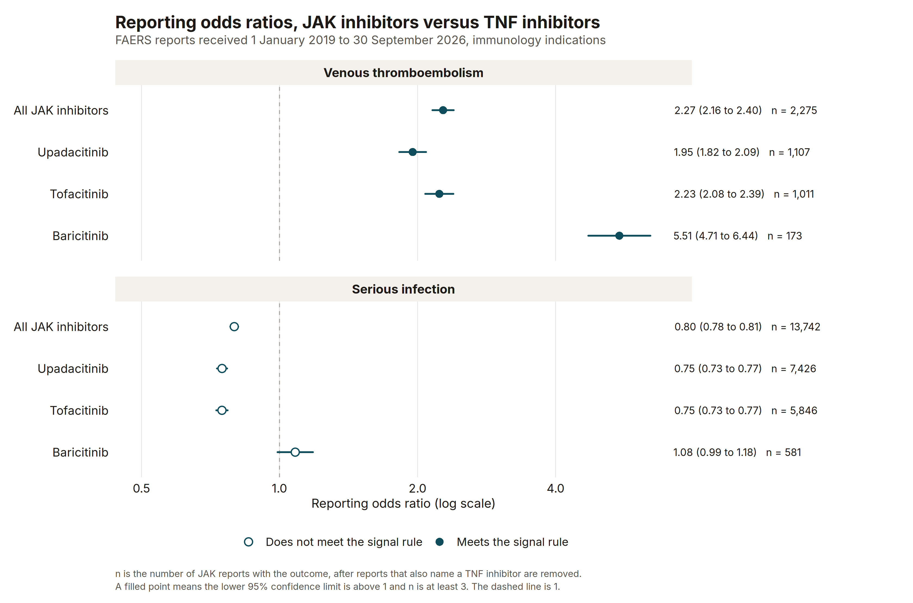

# JAK inhibitors and two safety outcomes in FAERS

Dr. Rishad Ahmed. PhD in Public Health, MBA.

A reporting screen of public FDA FAERS reports, JAK inhibitors against TNF inhibitors, for venous thromboembolism and serious infection. The counts come from the openFDA drug event API. The quarterly ASCII files were not downloaded.

This is not employer work and not a regulated submission. There is no denominator of users. The ratios are not incidences and they are not causal effects.

- [Case study](docs/case-study.qmd)

## The screen

openFDA drug event API counts of FDA FAERS reports received from 1 January 2019 through 30 September 2026, covering 2019 Q1 through 2026 Q3. The API last_updated field was 28 October 2026. Counts were retrieved 10 November 2026. September 2026 had 125,977 reports and October 2026 had 0 reports.

JAK versus TNF, venous thromboembolism: ROR 2.27 (95% CI 2.16 to 2.40), PRR 2.25, from 2,275 JAK reports with the outcome among 124,742 JAK reports and 3,401 TNF reports with the outcome among 419,632 TNF reports. The contrast meets the signal rule.

JAK versus TNF, serious infection: ROR 0.80 (95% CI 0.78 to 0.81), PRR 0.82, from 13,742 JAK reports with the outcome among 124,742 JAK reports and 56,431 TNF reports with the outcome among 419,632 TNF reports. The contrast does not meet the signal rule.



The other three figures are the quarterly VTE counts, the pre/post boxed-warning comparison, and the drug-by-outcome tile chart. They are in `output/` and in the case study. The signal rule is a lower 95% confidence limit above 1 and at least 3 JAK reports with the outcome.

## Run

From the repository root:

```bash
Rscript -e 'install.packages("renv", repos="https://cloud.r-project.org")'
Rscript -e 'renv::restore(project="faers-jak-tnf-signals", prompt=FALSE)'
Rscript faers-jak-tnf-signals/run.R
```

That command tests the estimators, requests the openFDA totals, and writes aggregate output to `output/`. Response bodies stay in `data/`, which is gitignored.

Stages:

```bash
Rscript faers-jak-tnf-signals/run.R test
Rscript faers-jak-tnf-signals/run.R fetch
Rscript faers-jak-tnf-signals/run.R estimate
Rscript faers-jak-tnf-signals/run.R check
```

`test` does not call the API. `check` confirms that the case study and the portfolio README still contain the sentences in `output/key-strings.txt` and `output/readme-strings.txt`.

`quarto render` reads `_quarto.yml` at the repository root.

## What is committed

Code, tests, the lockfile, the case study, and aggregate outputs (query totals, ratios, figures, provenance). Not the API cache.
