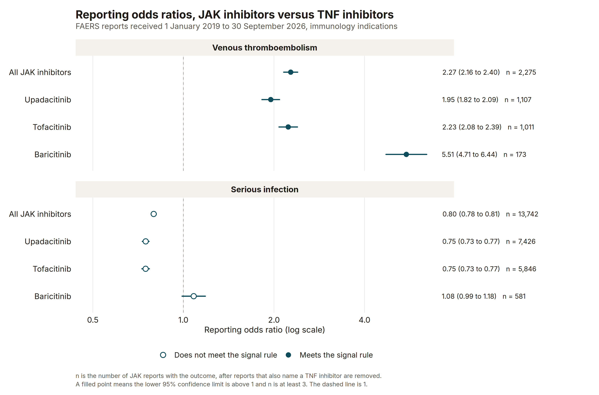
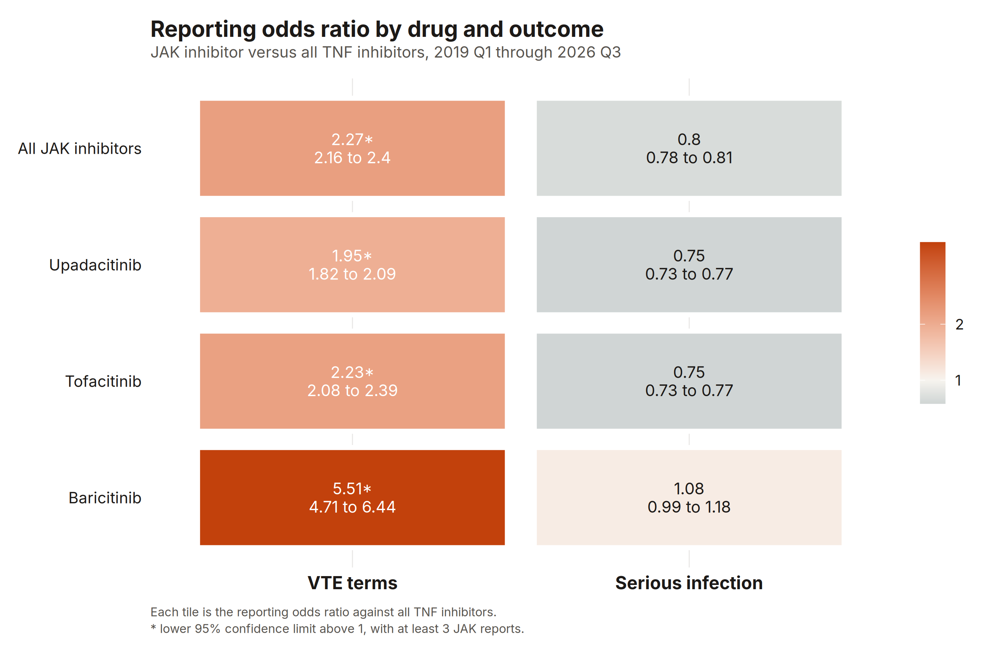
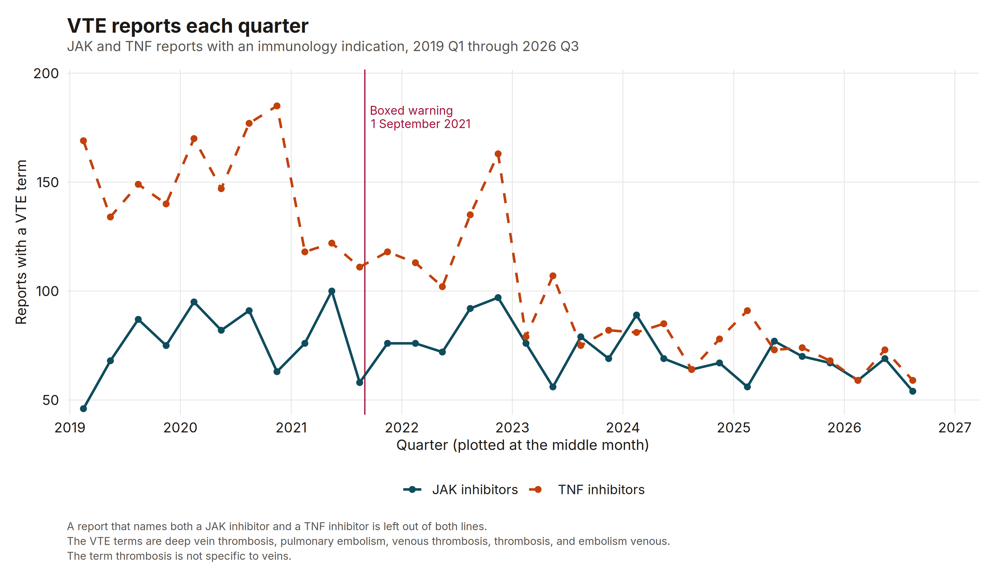
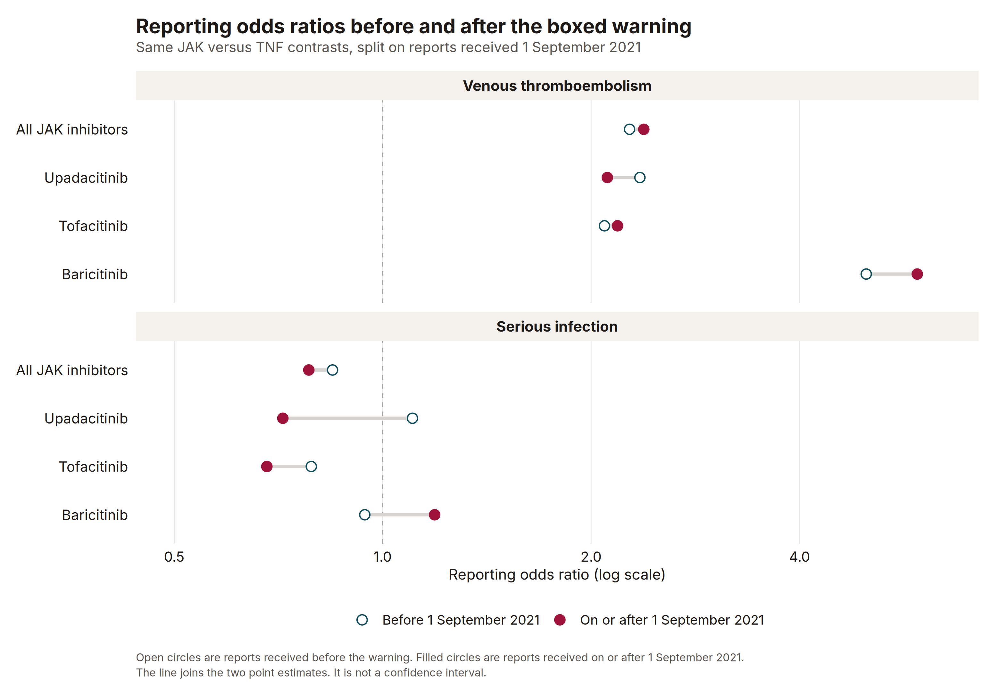

This is independent sample work on public FDA reports. I am not writing it for an employer. It is not a regulated submission, and it is not a claim that a drug causes a clot or an infection.

The question is a screening question. Among reports received from 1 January 2019 through 30 September 2026 that name an immunology indication, do JAK inhibitors have higher reporting odds of venous thromboembolism, and of serious infection, than the TNF inhibitors used in the same kinds of diseases?

## Why a sponsor would look

A sponsor who holds a JAK inhibitor, or a TNF inhibitor used for the same patients, gets this comparison in labeling reviews and in periodic safety reports. The boxed warning FDA required on 1 September 2021 named blood clots, serious infections, and other events for tofacitinib, baricitinib, and upadacitinib. The fair comparator is not the whole spontaneous-report database. It is the TNF inhibitors that treat rheumatoid arthritis, psoriatic arthritis, ankylosing spondylitis, ulcerative colitis, Crohn's disease, psoriasis, and atopic dermatitis.

A reporting odds ratio can show whether those events are reported disproportionately. It cannot show how often they happen in people who take the drug.

## What was counted

openFDA drug event API counts of FDA FAERS reports received from 1 January 2019 through 30 September 2026, covering 2019 Q1 through 2026 Q3. The API last_updated field was 28 October 2026. Counts were retrieved 10 November 2026. September 2026 had 125,977 reports and October 2026 had 0 reports.

The openFDA index holds 11,009,810 reports with a received date in that window.

I did not download the quarterly ASCII zips. A HEAD request to the 2026 Q3 zip URL returned HTTP 200, and the same request for 2026 Q4 returned HTTP 500. October 2026 has no reports in the API, so the window stops at the end of 2026 Q3. Each total is `meta.results.total` from `https://api.fda.gov/drug/event.json` with `limit=1`. The query URLs, the retrieval time, and the SHA-256 of each response body are in `output/provenance.json`.

A report counts for a drug when the ingredient token is on the harmonized generic name, the substance name, or the reported product, or when the originator brand is on the product text. The brands are Rinvoq, Xeljanz, Olumiant, Humira, Remicade, Enbrel, Cimzia, and Simponi. Salt forms and biosimilars that carry the ingredient token are included. I added the brands because the harmonized name alone misses a large share of Xeljanz and Olumiant reports.

I did not treat `drugcharacterization:1` as a primary-suspect flag. On this API that field is not tied to the same drug entry as the name, and in checks it removed almost none of the Xeljanz or Humira reports. Using it would have looked like a suspect-drug rule and would not have been one. Exposure here means the ingredient is named on the report.

The ASCII files can be cut to the latest `caseversion` for each `caseid`. That function is in `R/dedup.R` and the tests lock it. These totals did not pass through it. The count endpoint does not return a case id or a case version, so more than one version of a case can remain.

The indication filter is a phrase match on rheumatoid arthritis, psoriatic arthropathy, psoriatic arthritis, ankylosing spondylitis, colitis ulcerative, psoriasis, or dermatitis atopic, plus the token `crohn`. FAERS stores that indication as `Crohn^s disease`. A caret is not legal in an openFDA search, and the token is the match that remains. The indication is not tied to the same drug entry as the name.

Without the indication restriction, the same window has 224,224 JAK reports and 606,504 TNF reports.

With an immunology indication, 153,044 reports named a JAK inhibitor and 447,934 named a TNF inhibitor. 28,302 named both and are left out of the contrast, leaving 124,742 JAK reports and 419,632 TNF reports.

Venous thromboembolism is an exact match to five preferred terms: deep vein thrombosis, pulmonary embolism, venous thrombosis, thrombosis, and embolism venous. The term thrombosis is not specific to veins. Serious infection is `serious:1` and an exact match to a custom list, not a MedDRA SMQ. The list, as searched, is: pneumonia, pneumonia bacterial, pneumonia viral, pneumonia pneumococcal, covid-19 pneumonia, covid-19, sepsis, septic shock, cellulitis, urinary tract infection, herpes zoster, influenza, diverticulitis, pyelonephritis, pyelonephritis acute, osteomyelitis, tuberculosis, pulmonary tuberculosis, disseminated tuberculosis, infection, bacterial infection, viral infection, fungal infection, opportunistic infection, pneumocystis jirovecii pneumonia, lower respiratory tract infection, respiratory tract infection, candidiasis, oral candidiasis, oesophageal candidiasis, aspergillosis, cytomegalovirus infection, herpes simplex, bacteraemia, bacteremia, urosepsis, meningitis, endocarditis, appendicitis, abscess, clostridium difficile colitis, clostridium difficile infection, staphylococcal infection, streptococcal infection, necrotising fasciitis, necrotizing fasciitis, and arthritis bacterial.

The reporting odds ratio is (a/b) / (c/d), with a 95% interval of 1.96 on the log scale. The proportional reporting ratio is the ratio of the two proportions. A zero cell would add 0.5 to every cell. None of the contrasts in this run had a zero cell. The signal rule is a lower confidence limit above 1 and at least 3 JAK reports with the outcome. The only sensitivity split is the received date: before 1 September 2021, or on or after that date.

Reports that name the JAK drug in that row and any TNF inhibitor are removed from both arms. A report can still name two JAK drugs. It is counted once in the pooled row and can appear in more than one single-drug row.

## Results

JAK versus TNF, venous thromboembolism: ROR 2.27 (95% CI 2.16 to 2.40), PRR 2.25, from 2,275 JAK reports with the outcome among 124,742 JAK reports and 3,401 TNF reports with the outcome among 419,632 TNF reports. The contrast meets the signal rule.

JAK versus TNF, serious infection: ROR 0.80 (95% CI 0.78 to 0.81), PRR 0.82, from 13,742 JAK reports with the outcome among 124,742 JAK reports and 56,431 TNF reports with the outcome among 419,632 TNF reports. The contrast does not meet the signal rule.

The serious-infection ratio sits below 1. That is not evidence that JAK inhibitors protect against infection. It is a statement about the mix of reports.



Each single drug, against all TNF reports that do not also name that drug, tells the same VTE story with different width. Upadacitinib is 1.95 (95% CI 1.82 to 2.09), PRR 1.94, from 1,107 reports with a VTE term among 65,642. Tofacitinib is 2.23 (95% CI 2.08 to 2.39), PRR 2.21, from 1,011 among 55,989. Baricitinib is 5.51 (95% CI 4.71 to 6.44), PRR 5.30, from 173 among 3,730. All three meet the rule. The baricitinib arm is small, so I would not quote 5.51 as if it had the same stability as the tofacitinib ratio.

On serious infection, upadacitinib is 0.75 (95% CI 0.73 to 0.77) and tofacitinib is 0.75 (95% CI 0.73 to 0.77). Baricitinib is 1.08 (95% CI 0.99 to 1.18), PRR 1.07, from 581 reports, and the lower limit does not clear 1.



The quarter counts add up. After the same exclusion of reports that name both classes, the 31 quarters sum to 2,275 JAK VTE reports and 3,401 TNF VTE reports, which are the full-window numerators. The TNF line stays above the JAK line in every quarter through 2022. After that the gap is smaller, and in several quarters the two counts are nearly the same. JAK counts run from 46 in 2019 Q1 to 100 in 2021 Q2. They do not jump in the quarter of the warning: 2021 Q3 has 58 JAK reports and 111 TNF reports, against 100 and 122 in 2021 Q2.



For venous thromboembolism, the JAK versus TNF ROR was 2.27 (95% CI 2.09 to 2.47) before 1 September 2021 and 2.38 (95% CI 2.22 to 2.55) on or after that date.

For serious infection, the JAK versus TNF ROR was 0.85 (95% CI 0.82 to 0.88) before 1 September 2021 and 0.78 (95% CI 0.76 to 0.80) on or after that date.

The pooled VTE signal was already present before the boxed warning. The warning does not explain it away. It also does not prove the signal is a drug effect. The dumbbell is the single-drug version of that split.



Two single-drug rows move enough to matter. Upadacitinib serious infection was 1.10 (95% CI 1.03 to 1.19) before the warning, on 883 reports with the outcome among 5,591, and that contrast met the rule. On or after the warning it was 0.72 (95% CI 0.70 to 0.74) and did not. Baricitinib serious infection was 0.94 (95% CI 0.82 to 1.09) before the warning and 1.19 (95% CI 1.06 to 1.33) after, so the later slice meets the rule and the full-window baricitinib contrast does not. I would hand someone both slices, not only the pooled "no signal."



## What this is not

There is no count of users and no time on drug. Nothing here is an incidence, a rate, or a causal effect. FAERS records what was sent to FDA. Serious events, newer products, and events already named in a label are easier to report. Stimulated reporting after a warning is a real bias. In this run the VTE disproportion was present in the reports received before 1 September 2021, so that particular warning did not create the pooled signal. It can still change which events are written down.

The screen is not limited to the primary suspect drug, and it is not deduplicated to the latest case version. Both limits are in the method above. The preferred term thrombosis pulls in events that are not venous. The infection list is a documented set of strings, not a licensed SMQ, and a report that is serious for some other reason is counted if one of those strings is also present.

The indication filter is a phrase on the report, not a diagnosis attached to the drug. JAK inhibitors are often started after a TNF inhibitor has already failed, so the patients are not exchangeable. Baricitinib's 3,730 immunology reports are a thin arm next to the rest of the pool, and Olumiant's COVID-19 use can still leave a mark when an immunology indication was coded as well. Biosimilar brand names that are neither harmonized nor carrying the ingredient token can be missed. Originator brands were added to close the gap I could see, not every gap.

I would use the VTE signal as a reason to keep the labeled risk in view, and to prefer a study that has a denominator. I would not use the serious-infection ratio of 0.80 as evidence of a lower risk.

## Reproduce

From the repository root:

```bash
Rscript -e 'install.packages("renv", repos="https://cloud.r-project.org")'
Rscript -e 'renv::restore(project="faers-jak-tnf-signals", prompt=FALSE)'
Rscript faers-jak-tnf-signals/run.R
quarto render
```

`run.R` tests the odds ratio, the exclusive 2x2, the case-version rule, and the search text, then pulls the counts and redraws the figures. Cached responses stay in `data/`, which is gitignored. The tests do not call the API:

```bash
Rscript faers-jak-tnf-signals/run.R test
```

This run used R 4.3.3, ggplot2 4.0.3, and jsonlite 2.0.0. The page was rendered with Quarto 1.11.9. The figures are 300 dpi PNG files in `output/`.

## Sources

openFDA. Drug adverse event endpoint. [https://open.fda.gov/apis/drug/event/](https://open.fda.gov/apis/drug/event/) and [https://api.fda.gov/drug/event.json](https://api.fda.gov/drug/event.json). Index `last_updated` 28 October 2026.

U.S. Food and Drug Administration. FAERS quarterly data files. [https://fis.fda.gov/extensions/FPD-QDE-FAERS/FPD-QDE-FAERS.html](https://fis.fda.gov/extensions/FPD-QDE-FAERS/FPD-QDE-FAERS.html). The 2026 Q3 ASCII zip URL responded to a HEAD request. The file was not downloaded.

U.S. Food and Drug Administration. Drug safety communication, 1 September 2021. FDA requires warnings about increased risk of serious heart-related events, cancer, blood clots, and death for JAK inhibitors that treat certain chronic inflammatory conditions.
