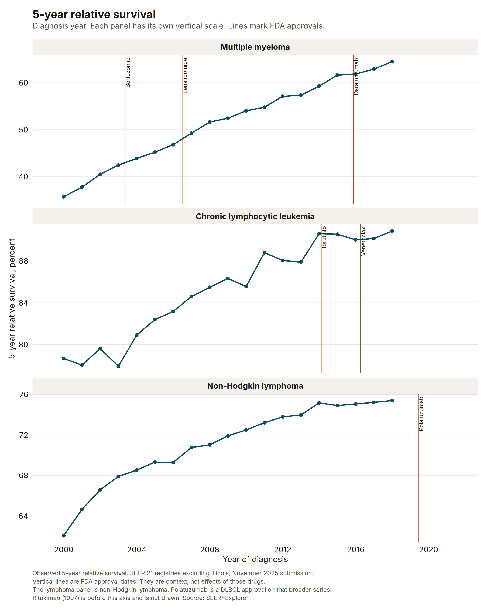

# Blood cancer incidence and survival in SEER

Dr. Rishad Ahmed. PhD in Public Health, MBA.

Age-adjusted incidence and 5-year relative survival for multiple myeloma, chronic lymphocytic leukemia, and non-Hodgkin lymphoma, from public SEER*Explorer rates. Diffuse large B-cell lymphoma is not its own site in that source.

This is not employer work. It is not a statement from Nebraska DHHS or from any company. The approval lines are context. SEER cannot tie survival to a drug.

- [Case study](docs/case-study.qmd)
- [Plan](docs/protocol.qmd)

## The series

SEER*Explorer aggregate rates from the SEER November 2025 submission, retrieved 13 November 2026. Incidence is the SEER 21 registries, age-adjusted to the 2000 US standard population, for 2000 through 2023. Five-year relative survival is the SEER 21 registries excluding Illinois. The last diagnosis year with an observed 5-year relative survival in this download is 2018.

Diffuse large B-cell lymphoma is not a separate cancer site in SEER*Explorer. The lymphoma series in this study is non-Hodgkin lymphoma.

Multiple myeloma 5-year relative survival was 35.7% for people diagnosed in 2000 (5,580 cases) and 64.5% for people diagnosed in 2018 (9,186 cases).

Chronic lymphocytic leukemia 5-year relative survival was 78.7% for people diagnosed in 2000 (4,228 cases) and 90.9% for people diagnosed in 2018 (6,440 cases).

Non-Hodgkin lymphoma 5-year relative survival was 62.0% for people diagnosed in 2000 (17,852 cases) and 75.4% for people diagnosed in 2018 (22,842 cases).

Observed age-adjusted incidence in 2023 was 7.6 per 100,000 for myeloma (14,197 cases), 4.8 for CLL (9,054 cases), and 18.4 for non-Hodgkin lymphoma (33,428 cases). In 2000 those rates were 6.1, 4.7, and 19.3.

The 5-year relative survival gap is White (includes Hispanic) minus Black (includes Hispanic). For multiple myeloma the gap was -2.8 percentage points in 2000 and -2.5 percentage points in 2018, so the Black group had the higher survival in both years. For CLL the gap was 12.8 percentage points in 2000 and 6.4 percentage points in 2018. For non-Hodgkin lymphoma the gap was 9.4 percentage points in 2000 and 3.2 percentage points in 2018.



The other two figures are the incidence trends and the survival gap. They are in `output/` and in the case study.

- [Incidence](output/figure-incidence-trends.png)
- [Survival gap](output/figure-survival-gap.png)

## Run

From the repository root:

```bash
Rscript -e 'install.packages("renv", repos="https://cloud.r-project.org")'
Rscript -e 'renv::restore(project="seer-heme-survival-trends", prompt=FALSE)'
Rscript seer-heme-survival-trends/run.R
```

That command tests the parser and the gap, requests the SEER*Explorer series, and writes aggregate output to `output/`. Response bodies stay in `data/`, which is gitignored.

Stages:

```bash
Rscript seer-heme-survival-trends/run.R test
Rscript seer-heme-survival-trends/run.R fetch
Rscript seer-heme-survival-trends/run.R estimate
Rscript seer-heme-survival-trends/run.R check
```

`test` does not call SEER. `check` confirms that the case study and the portfolio README still contain the sentences in `output/key-strings.txt` and `output/readme-strings.txt`.

`quarto render` reads `_quarto.yml` at the repository root.

## What is committed

Code, tests, the lockfile, the plan, the case study, and aggregate outputs (rates, gaps, figures, provenance). Not the JSON cache.
