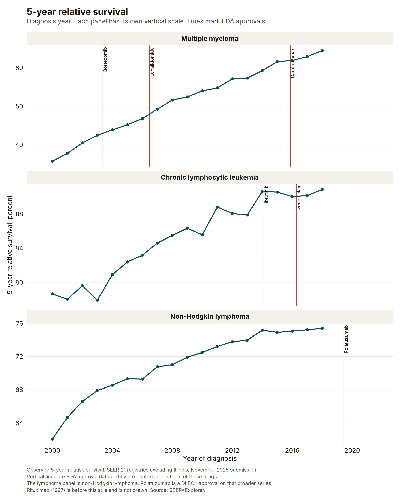
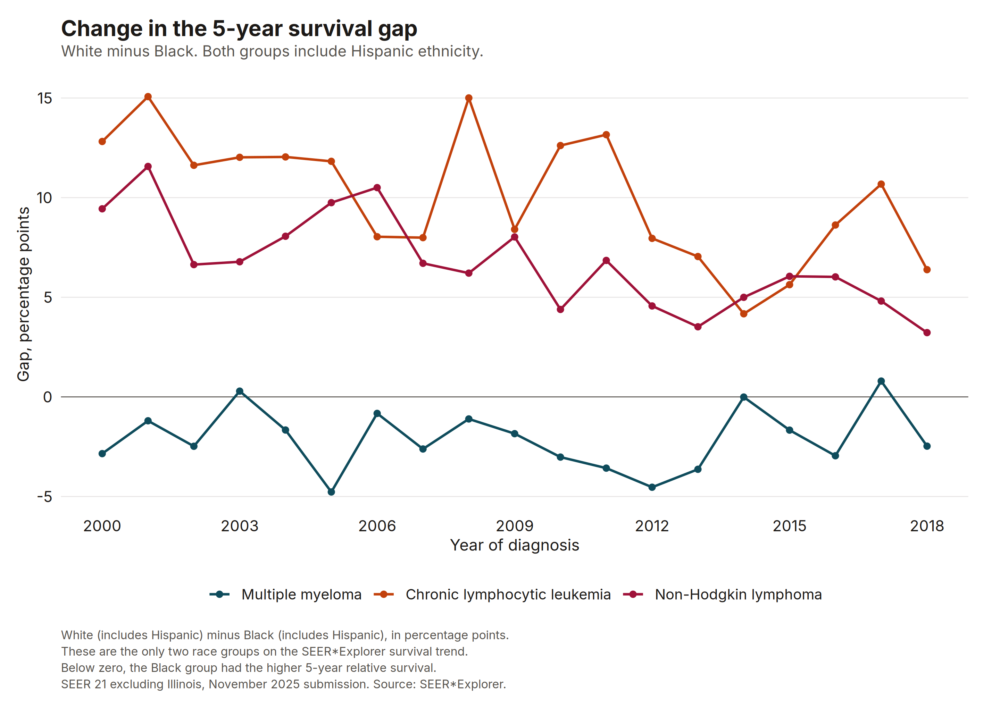
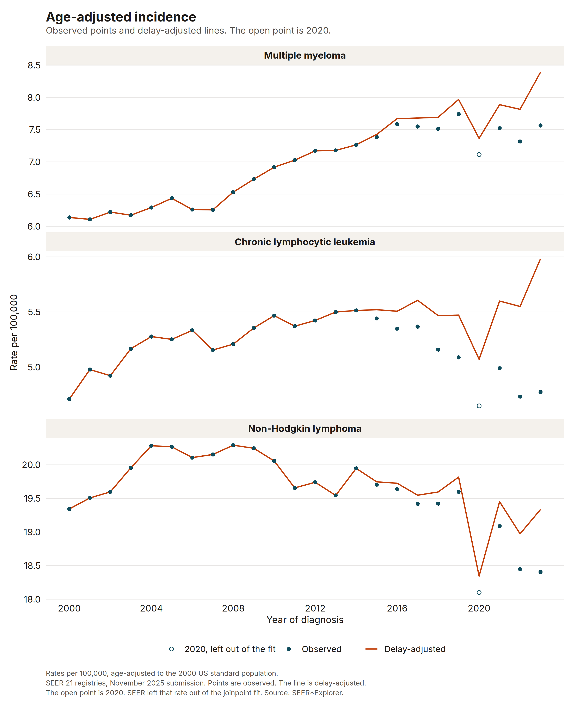

This is independent sample work on public SEER rates. I am not writing it for an employer. It is not a statement from Nebraska DHHS, and it is not a statement from Johnson & Johnson, AbbVie, Roche, or any other company.

The question is descriptive. From 2000 to the latest year the public tables cover, how did age-adjusted incidence and 5-year relative survival change for multiple myeloma, chronic lymphocytic leukemia, and non-Hodgkin lymphoma? Where the tables allow it, how do sex, age, and race or ethnicity differ, and how did the survival gap between the available race groups change?

A team that follows myeloma, CLL, or lymphoma would use a picture like this as background: is the disease becoming more common, and are people diagnosed in later years living longer, before anyone argues about a specific drug. The approval lines are there so a reader can see the treatment era. They are not effects.

## What was counted

SEER*Explorer aggregate rates from the SEER November 2025 submission, retrieved 13 November 2026. Incidence is the SEER 21 registries, age-adjusted to the 2000 US standard population, for 2000 through 2023. Five-year relative survival is the SEER 21 registries excluding Illinois. The last diagnosis year with an observed 5-year relative survival in this download is 2018.

Diffuse large B-cell lymphoma is not a separate cancer site in SEER*Explorer. The lymphoma series in this study is non-Hodgkin lymphoma.

I used the public JSON behind SEER*Explorer, the same responses the site uses to draw a chart. I did not use SEER*Stat case listings. Those need a signed data agreement. The bulk Excel archive on the data-archive page stops at the November 2024 submission, so it is a year behind the interactive site. Each request URL and the SHA-256 of the response are in `output/provenance.json`.

The site codes are myeloma 89, chronic lymphocytic leukemia 93, and non-Hodgkin lymphoma 86. Stage is all stages. Incidence is the observed age-adjusted rate, with a delay-adjusted series kept for both sexes and all ages. Survival is observed 5-year relative survival. A year is kept only when the estimate is present and the case count is at least 16. A modeled 5-year rate for a year with no observed 5-year rate is not copied into the table or the figure. The last observed survival year in this download is 2018, which is what five years of follow-up can support when incidence runs through 2023.

The survival trend offers three race groups: all races, White (includes Hispanic), and Black (includes Hispanic). Incidence also offers non-Hispanic White, non-Hispanic Black, Hispanic (any race), non-Hispanic Asian / Pacific Islander, and non-Hispanic American Indian / Alaska Native. I did not relabel the survival groups as non-Hispanic. American Indian / Alaska Native incidence is limited to Purchased/Referred Care Delivery Area counties. For CLL, only 5 diagnosis years have a published rate, so that group is left out of the summary table. The published years are in `incidence.csv`.

SEER fit the incidence trends in Joinpoint version 6.0 and left the 2020 rate out of the fit. The published APC is an annual percent change. The survival summary is an average absolute change in percentage points per year, not an annual percent change. A survival segment can end after the last observed 5-year rate because the model uses shorter follow-up.

## Survival

Multiple myeloma 5-year relative survival was 35.7% for people diagnosed in 2000 (5,580 cases) and 64.5% for people diagnosed in 2018 (9,186 cases).

Chronic lymphocytic leukemia 5-year relative survival was 78.7% for people diagnosed in 2000 (4,228 cases) and 90.9% for people diagnosed in 2018 (6,440 cases).

Non-Hodgkin lymphoma 5-year relative survival was 62.0% for people diagnosed in 2000 (17,852 cases) and 75.4% for people diagnosed in 2018 (22,842 cases).

The approval lines are context. SEER does not record the drug a person received, so a change in survival after an approval is not evidence that the drug caused it.



Myeloma 5-year relative survival, SEER average absolute change: 2000-2017, 1.5 percentage points per year (rising); 2017-2022, 0.3 percentage points per year (not significant).

CLL 5-year relative survival, SEER average absolute change: 2000-2016, 0.8 percentage points per year (rising); 2016-2022, 0.0 percentage points per year (not significant).

NHL 5-year relative survival, SEER average absolute change: 2000-2003, 1.7 percentage points per year (rising); 2003-2017, 0.5 percentage points per year (rising); 2017-2022, -0.5 percentage points per year (falling).

The myeloma rise is the obvious one, from about 36% to about 64%. It was already underway before daratumumab, and the observed series ends in 2018, so the 2015 approval sits on the later part of a rise that started much earlier. CLL was already high in 2000 and is about 91% for 2018 diagnoses. The ibrutinib and venetoclax lines fall in a period when the year-to-year change is small. Non-Hodgkin lymphoma rose from 62% to 75%. Polatuzumab vedotin's 2019 DLBCL approval is to the right of the last observed point. There is no observed 5-year survival yet for people diagnosed in that year. Rituximab was approved in 1997, before this axis.

The late negative segment for non-Hodgkin lymphoma is SEER's model through 2022. It is not an observed 5-year rate for 2022. The observed series itself is higher in 2018 than in 2000.

Sex barely separates myeloma survival: 64.6% for men and 64.4% for women diagnosed in 2018. CLL is higher for women (93.5% versus 89.2%). Non-Hodgkin lymphoma is higher for women (78.2% versus 73.1%). Age separates myeloma more than sex does. For 2018 diagnoses, 5-year relative survival was 82.9% under age 50 and 58.0% at 65 and older. Both are much higher than the same age bands in 2000 (55.3% and 27.1%).

## The survival gap

The 5-year relative survival gap is White (includes Hispanic) minus Black (includes Hispanic). For multiple myeloma the gap was -2.8 percentage points in 2000 and -2.5 percentage points in 2018, so the Black group had the higher survival in both years. For CLL the gap was 12.8 percentage points in 2000 and 6.4 percentage points in 2018. For non-Hodgkin lymphoma the gap was 9.4 percentage points in 2000 and 3.2 percentage points in 2018.



The myeloma gap stays near zero and slightly favors the Black group across the whole series. That is not the pattern for the other two cancers. CLL opens with a gap of about 13 points and ends near 6. Non-Hodgkin lymphoma opens near 9 points and ends near 3. Both gaps are smaller at the end than at the start, and neither has closed. The lines bounce, which is what a difference of two percentages does. I would not read a single year, such as the CLL spike near 2008, as a change in care.

These race groups include Hispanic ethnicity. They are not the non-Hispanic groups in the incidence table. A gap computed on a different race definition would be a different number, and this file does not contain that survival split.

## Incidence

Observed age-adjusted incidence in 2023 was 7.6 per 100,000 for myeloma (14,197 cases), 4.8 for CLL (9,054 cases), and 18.4 for non-Hodgkin lymphoma (33,428 cases). In 2000 those rates were 6.1, 4.7, and 19.3.

Delay-adjusted incidence in 2023 was 8.4 per 100,000 for myeloma, 6.0 for CLL, and 19.3 for non-Hodgkin lymphoma. The delay-adjusted rate sits above the observed rate in the most recent year.



Myeloma observed incidence, SEER joinpoint: 2000-2007 APC 0.5% per year (not significant); 2007-2011 APC 2.8% per year (rising); 2011-2019 APC 1.0% per year (rising); 2019-2023 APC -0.8% per year (falling).

Myeloma delay-adjusted incidence, SEER joinpoint: 2000-2023 APC 1.4% per year (rising).

The observed myeloma series rises from 6.1 to 7.6, with a dip in 2020 and a wobble after 2019. The delay-adjusted series does not turn down. It rises across 2000-2023. I would not describe the latest observed points as a real decline in myeloma incidence. They are what a registry looks like before the latest cases have all been reported, plus the 2020 shock that SEER already pulls out of the fit.

CLL observed incidence, SEER joinpoint: 2000-2004 APC 2.3% per year (rising); 2004-2015 APC 0.4% per year (not significant); 2015-2023 APC -1.8% per year (falling).

NHL observed incidence, SEER joinpoint: 2000-2004 APC 1.3% per year (rising); 2004-2019 APC -0.3% per year (falling); 2019-2023 APC -1.4% per year (falling).

CLL's observed rate in 2023 is close to its 2000 rate (4.8 versus 4.7), while the delay-adjusted 2023 rate is 6.0. The recent observed decline is the same kind of lag. Non-Hodgkin lymphoma is different. The delay-adjusted 2023 rate is 19.3, the same as 2000 to one decimal in the headline and 19.34 in the table, but SEER's delay-adjusted joinpoint is still slightly down from 2004 to 2023. The long drift down is not only a delay artifact. The 2020 point is low in every panel, and it is the open circle because SEER left it out of the fit.

Men have the higher incidence for all three cancers. In 2023 the observed myeloma rate was 9.40 per 100,000 in men and 6.08 in women. Non-Hispanic Black people have a much higher myeloma rate than non-Hispanic White people: 15.53 versus 6.71 in 2023, and 11.78 versus 5.58 in 2000. That gap in incidence is wide and did not narrow. CLL incidence is higher in non-Hispanic White people (6.00 in 2023) than in non-Hispanic Black people (3.27). Non-Hodgkin lymphoma is also higher in non-Hispanic White people (19.56 versus 13.75).

Myeloma remains a disease of older adults. The 2023 observed rate was 0.96 per 100,000 under age 50 and 39.59 at ages 65 and older. Survival improved in both bands, and the older band is still far lower.



## What this is not

There is no drug identifier on a SEER case in this file. A survival gain that lines up with an approval, or that started years before one, is not evidence for or against that drug. The lines mark dates I could verify at FDA. They do not mark exposure.

SEER 21 is not the whole United States. Survival here excludes Illinois. Relative survival compares people with the cancer to people of the same age, race, and sex in the general population. It is not the share who died of the cancer, and it is not a prediction for one patient.

The 2020 incidence rates are shown and were not used in SEER's joinpoint fit. Delay adjustment moves the most recent incidence rates up, a lot for myeloma and CLL. Race groups on the survival figure include Hispanic ethnicity. American Indian / Alaska Native rates have a geographic restriction and, for CLL, too many suppressed years to summarize. Counts under 16 are not in the committed tables.

I would hand someone the survival rise, the myeloma incidence difference by race, and the narrowing but still open CLL and non-Hodgkin lymphoma survival gaps. I would not hand them a sentence that says a drug caused any of it.

## Reproduce

From the repository root:

```bash
Rscript -e 'install.packages("renv", repos="https://cloud.r-project.org")'
Rscript -e 'renv::restore(project="seer-heme-survival-trends", prompt=FALSE)'
Rscript seer-heme-survival-trends/run.R
quarto render
```

`run.R` tests the parser, the gap, and the request list, then downloads the SEER*Explorer JSON and redraws the figures. Cached responses stay in `data/`, which is gitignored. The tests do not call SEER:

```bash
Rscript seer-heme-survival-trends/run.R test
```

This run used R 4.3.3, ggplot2 4.0.3, and jsonlite 2.0.0. The page was rendered with Quarto 1.11.9. The figures are 300 dpi PNG files in `output/`.

## Sources

Surveillance Research Program, National Cancer Institute. SEER*Explorer. [https://seer.cancer.gov/statistics-network/explorer/](https://seer.cancer.gov/statistics-network/explorer/). November 2025 submission, application updated 22 April 2026 and 22 June 2026. Rates retrieved 13 November 2026.

National Cancer Institute. SEER*Explorer data archive. [https://seer.cancer.gov/statistics-network/explorer/archive.html](https://seer.cancer.gov/statistics-network/explorer/archive.html). The Excel archive on that page stops at the November 2024 submission.

National Cancer Institute. Cancer site definitions for SEER*Explorer. [https://seer.cancer.gov/statistics-network/explorer/cancer-sites.html](https://seer.cancer.gov/statistics-network/explorer/cancer-sites.html).

U.S. Food and Drug Administration. Orphan drug designation for bortezomib, marketing approval 13 May 2003. [https://www.accessdata.fda.gov/scripts/opdlisting/oopd/detailedIndex.cfm?cfgridkey=163002](https://www.accessdata.fda.gov/scripts/opdlisting/oopd/detailedIndex.cfm?cfgridkey=163002). The same date is on the FDA verified-clinical-benefit table.

U.S. Food and Drug Administration. Orphan drug designation for lenalidomide, marketing approval 29 June 2006, with dexamethasone for multiple myeloma after at least one prior therapy. [https://www.accessdata.fda.gov/scripts/opdlisting/oopd/detailedIndex.cfm?cfgridkey=147701](https://www.accessdata.fda.gov/scripts/opdlisting/oopd/detailedIndex.cfm?cfgridkey=147701).

U.S. Food and Drug Administration. Approval letter for daratumumab, BLA 761036, effective approval date 16 November 2015. [https://www.accessdata.fda.gov/drugsatfda_docs/appletter/2015/761036Orig1s000ltr.pdf](https://www.accessdata.fda.gov/drugsatfda_docs/appletter/2015/761036Orig1s000ltr.pdf).

U.S. Food and Drug Administration. Orphan drug designation for ibrutinib, marketing approval 12 February 2014 for CLL after at least one prior therapy. [https://www.accessdata.fda.gov/scripts/opdlisting/oopd/detailedIndex.cfm?cfgridkey=368012](https://www.accessdata.fda.gov/scripts/opdlisting/oopd/detailedIndex.cfm?cfgridkey=368012).

U.S. Food and Drug Administration. Approval package for venetoclax, NDA 208573, approval date 11 April 2016. [https://www.accessdata.fda.gov/drugsatfda_docs/nda/2016/208573Orig1s000Approv.pdf](https://www.accessdata.fda.gov/drugsatfda_docs/nda/2016/208573Orig1s000Approv.pdf).

U.S. Food and Drug Administration. Orphan drug designation for rituximab, marketing approval 26 November 1997. [https://www.accessdata.fda.gov/scripts/opdlisting/oopd/detailedIndex.cfm?cfgridkey=79793](https://www.accessdata.fda.gov/scripts/opdlisting/oopd/detailedIndex.cfm?cfgridkey=79793).

U.S. Food and Drug Administration. Orphan drug designation for polatuzumab vedotin, marketing approvals 10 June 2019 and 19 April 2023. [https://www.accessdata.fda.gov/scripts/opdlisting/oopd/detailedIndex.cfm?cfgridkey=547416](https://www.accessdata.fda.gov/scripts/opdlisting/oopd/detailedIndex.cfm?cfgridkey=547416). The figure uses 10 June 2019. The Purple Book original approval date and the signed approval letter agree with that date. The approval-package cover also prints 6 June 2019.
